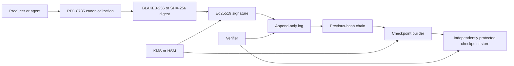
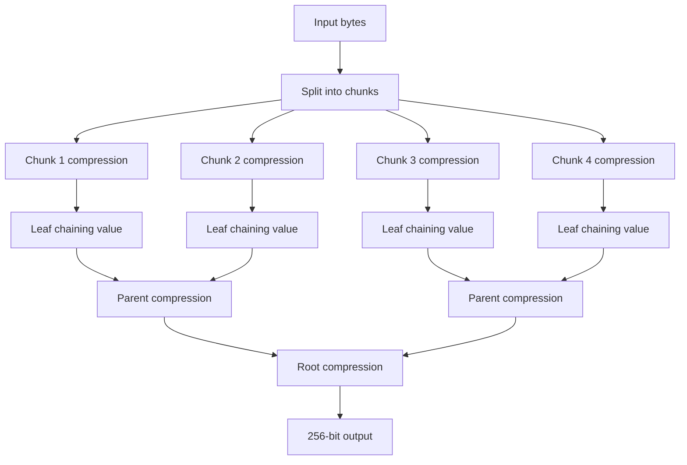
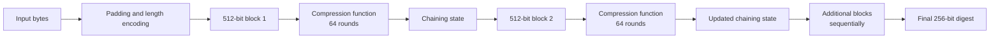

# JSON Message Integrity System

## Technical Design Specification

| Field | Value |
|---|---|
| Document status | Design baseline |
| Intended audience | Engineering, security, platform, audit, and operations teams |
| Scope | Integrity, authenticity, ordering, append-only retention, and verification of JSON messages |
| Hash options | BLAKE3-256 or SHA-256 |
| Signature algorithm | Ed25519 |
| Canonicalization | RFC 8785 JSON Canonicalization Scheme |

## 1. Executive summary

This specification defines a layered integrity system for JSON messages. The system canonicalizes each message, computes a cryptographic digest, links records through previous-hash references, authenticates records with Ed25519 signatures, stores finalized records through append-only controls, and publishes independently protected signed checkpoints.

The resulting security property is **storage-enforced immutability with cryptographic tamper evidence**:

- Application accounts cannot update or delete finalized records.
- Corrections are appended as new records rather than applied in place.
- Modifying a message or hash invalidates the affected signature and subsequent chain links.
- Independently protected checkpoints detect replacement of an entire history.

Cryptography does not prevent a privileged attacker from rewriting every storage layer and every trust anchor simultaneously. The design therefore treats independent checkpoints, key protection, immutable storage, and operational separation as essential controls rather than optional enhancements.

## 2. Scope and objectives

The system is intended for JSON messages produced by agents, services, users, or other event-producing components. A message may be an agent response, an application event, a tool result, or a correction event.

The system shall:

1. Produce deterministic bytes for logically equivalent JSON messages.
2. Detect changes to message content and integrity metadata.
3. Authenticate records with an authorized signing key.
4. Link records in a deterministic sequence.
5. Prevent normal modification and deletion of finalized records.
6. Support append-only corrections and cancellation events.
7. Provide independently verifiable evidence through signed checkpoints.
8. Distinguish record validity from proof of complete history.

The system does not, by itself, establish that the business content of a message is truthful, prevent denial of service, or prevent replay of a valid message. Application-level authorization, idempotency, and freshness controls remain necessary.

## 3. System architecture



The primary log and the checkpoint store are separate trust domains. The signing key used for checkpoints must not be controlled solely by the administrator of the primary log.

## 4. Requirements

### 4.1 Functional requirements

| ID | Requirement |
|---|---|
| FR-01 | The system shall canonicalize JSON using RFC 8785 before hashing. |
| FR-02 | The system shall support BLAKE3-256 and SHA-256 with an explicit algorithm identifier. |
| FR-03 | Each record shall contain a previous-hash reference, except the defined genesis record. |
| FR-04 | Each finalized record shall be signed with Ed25519. |
| FR-05 | The application API shall expose append and read operations for finalized records, but no update or delete operation. |
| FR-06 | Corrections shall be represented as new records that reference the original record. |
| FR-07 | The system shall publish signed checkpoints to an independently protected store. |
| FR-08 | The verifier shall return specific failure reasons and evidence, not only a Boolean result. |

### 4.2 Security objectives

| Objective | Evidence |
|---|---|
| Message integrity | Canonical JSON bytes and a cryptographic digest. |
| Authenticity | Ed25519 signature and trusted public-key record. |
| Ordering continuity | Sequence number and previous-hash link. |
| Storage immutability | Append-only API, WORM or immutable storage, and access controls. |
| History anchoring | Independently stored signed checkpoint. |
| Auditability | Append receipts, access logs, key state, and verification evidence. |

## 5. Threat model and trust assumptions

The attacker may control message transport, a message producer, a log reader, or an administrator of one storage system. The attacker may attempt to:

- Modify JSON fields or their encoding.
- Replace a record with another valid-looking record.
- Change a previous hash or sequence number.
- Insert, delete, or reorder records.
- Replay a previously valid message.
- Replace or misuse a signing key.
- Rewrite an entire history from a new genesis point.

The following assumptions apply:

1. At least one signing key and one checkpoint trust anchor remain outside the control of the primary log administrator.
2. The verifier has access to the applicable public-key records and trusted checkpoints.
3. Storage immutability and access policies are enforced by the deployment platform, not merely documented.
4. The verifier checks the complete relevant chain rather than an isolated record only.

Hash chains alone do not prove that the presented history is complete. A complete rewrite can be internally consistent if all records, starting points, and trust anchors are replaced together. Independent checkpoints reduce this risk by preserving evidence outside the mutable log.

## 6. Record model

A record should contain at least:

```json
{
  "protocol": "json-integrity/v1",
  "conversation_id": "conversation-123",
  "record_id": "record-456",
  "sequence_number": 42,
  "sender_type": "agent",
  "hash_algorithm": "blake3-256",
  "payload_hash": "b3-256:...",
  "previous_hash": "b3-256:...",
  "key_id": "signing-key-2026-01",
  "payload": {
    "content": "Finalized agent response"
  },
  "signature": "base64url..."
}
```

The payload, integrity metadata, and signature context must be clearly separated. Fields that influence verification decisions must be included in the signed envelope.

## 7. Canonicalization

JSON permits multiple byte representations of the same logical value. Differences may include whitespace, object member order, number formatting, Unicode escaping, and equivalent representations. Hashing source JSON bytes directly is therefore insufficient.

RFC 8785 JSON Canonicalization Scheme shall be used to produce deterministic UTF-8 bytes. Implementations shall not substitute pretty-printed JSON or ordinary parser serialization unless the serializer has been demonstrated to conform to RFC 8785.

The canonical bytes are the input to the selected digest algorithm. The canonicalization implementation should be covered by known-answer and cross-language interoperability tests.

## 8. Hash selection and chain construction

### 8.1 Hash selection

The deployment may select either of the following:

- **BLAKE3-256:** preferred where high throughput and efficient content addressing are important and FIPS validation is not required.
- **SHA-256:** preferred where FIPS-validated cryptography, existing compliance controls, or broad compatibility is required.

### 8.1.1 Algorithm comparison

| Consideration | BLAKE3-256 | SHA-256 |
|---|---|---|
| Primary advantage | Very high hashing throughput and efficient parallel processing. | Broad compatibility and established compliance support. |
| Digest size | 256 bits, 32 bytes. | 256 bits, 32 bytes. |
| FIPS suitability | Not generally the default choice for FIPS-controlled deployments. | Common choice when used through a FIPS-validated cryptographic module. |
| Ecosystem compatibility | Strong in modern systems, but less universally available than SHA-256. | Widely supported across programming languages, tools, databases, and audit systems. |
| Performance profile | Typically faster, especially for large inputs and parallel workloads. | Slower than BLAKE3 in many workloads, but usually sufficient for ordinary message volumes. |
| Recommended use | Performance-sensitive deployments without a FIPS requirement. | Regulated, compliance-focused, or interoperability-sensitive deployments. |
| Migration consideration | Record `blake3-256` explicitly and validate support in every verifier. | Record `sha-256` explicitly and validate the approved implementation or module. |

The two algorithms provide the same 256-bit digest length for this design. The choice is primarily an operational and compliance decision, not a reason to change the record structure. The selected algorithm must be recorded with each digest, and all verifiers must reject an unsupported or unexpected algorithm identifier.

### 8.1.2 Internal construction comparison

The two algorithms have different internal designs. The following diagrams are conceptual rather than implementation-level specifications.

#### BLAKE3-256 architecture

BLAKE3 processes input in chunks, computes chaining values for the chunks, and combines those values through a binary tree. Independent chunks can be processed in parallel. BLAKE3 uses a BLAKE2s-derived compression function and supports extendable output, although this system uses a 256-bit output.



#### SHA-256 architecture

SHA-256 follows a Merkle–Damgård construction. After padding, the message is divided into sequential 512-bit blocks. Each block passes through a compression function that updates a 256-bit internal state. The final state is the 256-bit digest.



| Internal characteristic | BLAKE3-256 | SHA-256 |
|---|---|---|
| Overall construction | BLAKE2s-derived compression function arranged as a binary hash tree. | Merkle–Damgård construction with sequential block processing. |
| Parallelism | High: independent chunks and tree branches can be processed in parallel. | Limited at the basic message level because blocks depend on the previous chaining state. |
| Input processing | Chunked input with leaf and parent chaining values. | Padded 512-bit message blocks. |
| Compression design | BLAKE2s-family compression with tree-position and mode flags. | 64-round SHA-256 compression function. |
| Internal state model | Chaining values combined through a tree; root output can support XOF mode. | 256-bit chaining state updated for each block. |
| Output used here | First 256 bits of the BLAKE3 output stream. | Native 256-bit digest. |
| Main implementation benefit | Efficient parallel and incremental hashing. | Mature, widely implemented, and broadly supported. |

| Architecture layer | BLAKE3-256 deployment | SHA-256 deployment |
|---|---|---|
| Canonicalization | RFC 8785 | RFC 8785 |
| Digest operation | BLAKE3-256 | SHA-256 through the approved implementation or module |
| Record metadata | `hash_algorithm = blake3-256` | `hash_algorithm = sha-256` |
| Chain construction | Same previous-hash model | Same previous-hash model |
| Signature layer | Same Ed25519 envelope | Same Ed25519 envelope |
| Storage layer | Same append-only or WORM controls | Same append-only or WORM controls |
| Checkpoint layer | Same independent signed checkpoint model | Same independent signed checkpoint model |
| Verifier behavior | Reject unexpected or unsupported algorithms | Reject unexpected or unsupported algorithms |

The selected algorithm shall be recorded with every digest. SHA-256 is not automatically FIPS-compliant merely because the algorithm is SHA-256; the implementation and cryptographic module must satisfy the applicable FIPS requirements.

### 8.2 Previous-hash chain

For record `n`:

```text
payload_hash_n = HASH(domain_payload || canonical_payload_n)
record_hash_n  = HASH(domain_chain || record_metadata_n || payload_hash_n || previous_hash_n)
previous_hash_n = record_hash_(n-1)
```

The genesis record uses a defined genesis value. Every subsequent record references the immediately preceding record hash.

If a message or hash in the middle of the chain is edited:

1. The edited record's signature fails.
2. The next record's `previous_hash` no longer matches.
3. Every subsequent link fails unless the chain is rebuilt.
4. A trusted checkpoint detects a rebuilt or replaced history.

## 9. Ed25519 signatures and key management

Ed25519 shall sign the canonical signed envelope or a precisely defined canonical digest representation. Signatures authenticate the signing key and covered content. They do not, by themselves, prevent deletion, replay, or denial of service.

Key-management requirements include:

- Generate keys with a cryptographically secure random generator.
- Prefer KMS or HSM-backed signing operations in production.
- Assign stable key IDs and record algorithm, creation time, owner, and intended use.
- Publish new public keys before using them and checkpoint key-registry state.
- Define rotation and revocation behavior for historical records.
- Separate signing permission from log administration and checkpoint administration.
- Protect recovery material and never silently regenerate a key under an existing ID.

Algorithm substitution and unexpected key types shall be rejected.

## 10. Append-only storage and corrections

Append-only storage is an operational property, not a cryptographic primitive. The application shall expose append and read operations for finalized records and shall not expose update or delete operations to application accounts.

Production storage should use one or more of the following:

- WORM or immutable object retention.
- Append-only database tables or logs.
- Object-lock or retention enforcement at the storage layer.
- Separate credentials for application access, storage administration, signing, and checkpoint publication.
- Audit logs for reads, appends, rejected submissions, deletion attempts, and policy changes.

Corrections shall be appended as new records:

```text
Record 101: original message
Record 102: correction event referencing Record 101
Record 103: replacement message referenced by Record 102
```

The original record remains immutable and may be marked `superseded`, `cancelled`, or `retracted` by a later event. User-facing applications may hide superseded content while preserving the audit history.

## 11. Independently protected checkpoints

A checkpoint periodically commits to the history by signing a tuple containing:

```text
log_id
last_sequence_number
last_chain_hash
range_start
range_end
hash_algorithm
key_registry_digest
checkpoint_version
```

The checkpoint shall be stored outside the primary log's administrative and failure domain. Independence should include separate credentials, storage controls, monitoring, backup procedures, and signing authority.

Checkpoints limit the interval in which an undetected rewrite could occur and provide an external trust anchor for offline verification.

## 12. Verification algorithm

The verifier shall:

1. Parse the record using strict JSON validation.
2. Validate the protocol version and required fields.
3. Canonicalize the payload using RFC 8785.
4. Recompute the selected BLAKE3-256 or SHA-256 payload digest.
5. Verify the Ed25519 signature using the trusted public key and key policy.
6. Recompute the record hash.
7. Compare `previous_hash` with the prior record hash.
8. Check sequence numbers, record identity, duplicate policy, and replay controls.
9. Compare the terminal chain hash and range with an applicable trusted checkpoint.
10. Return a structured result identifying the first failing check and the evidence examined.

Verification outcomes should distinguish:

| Outcome | Meaning |
|---|---|
| Valid and anchored | Record, signature, chain, and checkpoint pass. |
| Valid but unanchored | Record and signature pass, but no trusted checkpoint covers it. |
| Chain break | A previous-hash or sequence link fails. |
| Signature failure | Signed content, key, or signature is invalid. |
| Replay suspected | Cryptography passes but application freshness or idempotency policy rejects reuse. |
| Incomplete evidence | Presented records verify, but deletion or omission cannot be ruled out. |

## 13. Python reference implementation

The following example illustrates algorithm selection and chain hashing. Production implementations shall use maintained libraries and explicit validation and error handling.

```python
import hashlib
from blake3 import blake3

DOMAIN = b"json-integrity payload v1\x00"

def digest(data: bytes, algorithm="blake3-256") -> bytes:
    if algorithm == "blake3-256":
        return blake3(data).digest(length=32)
    if algorithm == "sha-256":
        return hashlib.sha256(data).digest()
    raise ValueError("unsupported hash algorithm")

def payload_hash(canonical_payload: bytes, algorithm="blake3-256") -> bytes:
    return digest(DOMAIN + canonical_payload, algorithm)

def chain_hash(record_id, payload_digest, previous_digest, key_id,
               algorithm="blake3-256"):
    material = b"json-integrity chain v1\x00" + b"|".join([
        record_id.encode("utf-8"),
        payload_digest.hex().encode(),
        previous_digest.hex().encode(),
        key_id.encode("utf-8")
    ])
    return digest(material, algorithm)
```

The canonicalization function is intentionally not hand-written here. Ordinary `json.dumps` is not a substitute for a conforming RFC 8785 implementation.

## 14. Production considerations

| Area | Recommended practice |
|---|---|
| Performance | Measure canonicalization, hashing, signing, and checkpoint latency separately. |
| Concurrency | Allocate sequence numbers transactionally and serialize previous-hash decisions. |
| Multiple writers | Use per-partition chains and a checkpoint manifest covering all partitions. |
| Backups | Treat backups as independent evidence only when separately protected and monitored. |
| Observability | Alert on chain gaps, duplicate IDs, signature failures, checkpoint lag, and storage-policy violations. |
| Privacy | Treat linkable hashes and identifiers as potentially sensitive data. |
| Migration | Version canonicalization, hash, signature, and checkpoint formats; support dual verification during migration. |
| Incident response | Preserve raw evidence, checkpoint exports, key status, access logs, and verifier version. |

## 15. Limitations and testing plan

### 15.1 Limitations

A valid signature does not prove that the message's business content is true. A valid record can be replayed unless application-level freshness and idempotency controls are used. A hash chain can be rewritten in full if all trusted anchors are replaced. Independent checkpoints reduce this risk only when their trust domain, key material, storage, retention, and monitoring are genuinely separate.

### 15.2 Testing plan

- **Canonicalization:** object order, whitespace, Unicode, escaped characters, negative zero, large and small numbers, duplicate keys, and invalid JSON.
- **Hashing:** known-answer vectors for BLAKE3-256 and SHA-256, domain separation, algorithm identifiers, and cross-language agreement.
- **Signatures:** valid signatures, altered payloads, altered metadata, wrong key, revoked key, malformed signature, and algorithm mismatch.
- **Chains:** genesis, insertion, deletion, reorder, fork, duplicate sequence, and concurrent writers.
- **Checkpoints:** missing checkpoint, mismatched terminal hash, replaced checkpoint, key-registry changes, and checkpoint publication failure.
- **Replay:** duplicate event IDs, nonce reuse, timestamps, out-of-order delivery, and legitimate retries.
- **Storage:** partial append, crash recovery, backup restore, deletion attempts, permission drift, and object-lock expiration attempts.
- **Independent verification:** validate exported evidence with a second implementation or offline verifier that does not contact the primary service.

The system is ready for production when an independent verifier can reproduce the documented decision from an exported record range, the applicable public-key and checkpoint evidence, and the protocol version alone.
